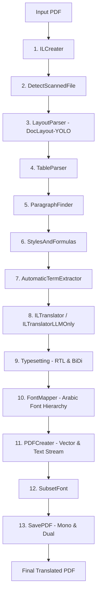

# Doc-Translator V2.1: System Architecture & Pipeline

## 1. Overview
Doc-Translator V2.1 (TransDOC) transforms complex PDF documents from English (LTR) into Arabic (RTL) while preserving the exact layout, geometry, typography, vector drawings, tables, and charts of the original document.

The architecture is built on an **Intermediate Language (IL)** representation that decouples PDF parsing, layout analysis, translation, typesetting, and PDF generation into 13 distinct sequential stages.

Version labels describe different layers: `pyproject.toml` declares BabelDOC package version `0.5.16`, the TransDOC documentation uses product label `V2.1`, and `server.py` exposes API version `1.0.0`; they are not interchangeable release numbers.

---

## 2. The 13 Translation Pipeline Stages

The pipeline is coordinated by `babeldoc.format.pdf.high_level.async_translate` and uses the following stage weights for progress monitoring:

| Stage # | Stage Class Name | Typical Weight (%) | Core Responsibility |
|---|---|---|---|
| 1 | `ILCreater` | 14.12% | Reads PDF using PyMuPDF and pdfminer. Converts raw text spans, fonts, curves, rectangles, and images into the `il_version_1.Document` object. |
| 2 | `DetectScannedFile` | 2.45% | Analyzes character density vs raster image coverage. Raises early warnings if document is purely scanned images. |
| 3 | `LayoutParser` | 14.03% | Runs YOLO ONNX model (`DocLayout-YOLO`) to segment pages into semantic bounding regions: titles, plain text, headers, footers, tables, figures. |
| 4 | `TableParser` | 1.00% | Detects table cells, column widths, row heights, and table borders. Ensures table cells are isolated from text reflow. |
| 5 | `ParagraphFinder` | 6.26% | Merges fragmented character spans into cohesive logical paragraphs, establishing correct reading order and line bounding boxes. |
| 6 | `StylesAndFormulas` | 1.66% | Identifies inline math formulas, subscripts/superscripts, and LaTeX tokens; wraps them in protected formula placeholders. |
| 7 | `AutomaticTermExtractor` | 30.00% | Extracts recurrent domain entities, acronyms, and statistical labels (especially in OpenAI LLM mode) to build a dynamic bilingual glossary. |
| 8 | `ILTranslator` | 46.96% | Protects numerals/acronyms (`_protect_numerals`), passes text to the translation model (NLLB, MarianMT, OpenAI), normalizes Arabic, and shapes glyphs. |
| 9 | `Typesetting` | 4.71% | Recomputes word wrapping, scale, vertical line positions, RTL right alignment, bullet hanging indents, and line-level BiDi reordering. |
| 10 | `FontMapper` | 0.61% | Maps original fonts to target Arabic fonts (`GoNotoKurrent-Regular.ttf`, `GoNotoKurrent-Bold.ttf`) while preserving bold weights. |
| 11 | `PDFCreater` | 1.96% | Generates raw PDF drawing operators, content streams, transformation matrices, and embedded graphics. |
| 12 | `SUBSET_FONT_STAGE_NAME` | 0.92% | Strips unused glyphs from embedded TrueType fonts to minimize final PDF file size. |
| 13 | `SAVE_PDF_STAGE_NAME` | 6.34% | Writes out the final PDF. Produces both `.mono.pdf` (monolingual Arabic) and `.dual.pdf` (side-by-side bilingual). |

---

## 3. Core Data Structures (`il_version_1.py`)

All stages operate on a shared object model serialized or stored in memory:

### `Box`
Represents a rectangular bounding box with 4 coordinates:
- `x`: Left edge (in points, 72 pt = 1 inch)
- `y`: Bottom edge
- `x2`: Right edge
- `y2`: Top edge
- `width`: `x2 - x`
- `height`: `y2 - y`

### `PdfParagraph`
The primary unit of translation and layout:
- `box`: Outer bounding box on the page
- `layout_label`: Semantic category (`title`, `plain text`, `page_header`, `page_footer`, `page_number`, `figure_caption`, `table_cell`, `list_item`)
- `unicode`: Original source text
- `trans_unicode`: Translated target text
- `scale`: Optimal scaling factor applied during typesetting
- `first_line_indent`: Detected indentation for the first line
- `pdf_paragraph_composition`: Collection of individual character/glyph placements

### `TypesettingUnit`
Represents an indivisible layout unit (a single character or inline formula):
- `unicode`: The character glyph
- `font`: Resolved font object
- `font_size`: Point size
- `width`: Measured character width at scale 1.0
- `height`: Character height
- `is_space`: Boolean flag indicating whitespace
- `can_passthrough`: True for numbers, symbols, or un-translated elements

---

## 4. Mono vs Dual PDF Output Generation

During `high_level.py` execution:
1. **Mono Output (`.mono.pdf`)**:
   - The original English text is replaced in-place with the Arabic translation.
   - Geometry, margins, and alignments are flipped to RTL while retaining the exact document layout.
2. **Dual Output (`.dual.pdf`)**:
   - Each page is doubled or rendered side-by-side: English source on the left, Arabic translation on the right.
   - Ideal for legal, financial, and executive reviews where side-by-side verification is required.
