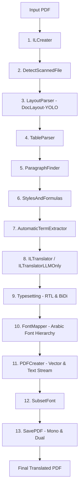

# TransDOC (Doc-Translator V2.1) — Architecture, Error Diagnostics & Strategy Brief

> **Target Audience**: AI Engineering Agents (Claude, GPT, DeepSeek) & System Maintainers  
> **Purpose**: Provide complete architectural context, exact log error analysis, line-by-line code causality, and the technical resolution strategy for TransDOC V2.1.

---

## 1. System Architecture & Core Strategy

### 1.1 Project Identity & Core Challenge
**TransDOC (Doc-Translator V2.1)** is an enterprise document translation and typesetting platform built on top of the **BabelDOC Intermediate Language (IL)** framework. It specializes in high-fidelity **English-to-Arabic (LTR to RTL) PDF document translation** for:
- Government policy publications (Qatar NDS3)
- Central bank & macroeconomic bulletins (Qatar Central Bank / QCB)
- Dense financial tables (IBAN tables, SWIFT BIC rosters, monetary data)
- Technical publications with vector charts, equations, and footnotes

#### Why PDF Translation is Hard: The Coordinate vs. Reflow Mismatch
In web documents, applying CSS (`direction: rtl`) causes the browser rendering engine to automatically reflow text boxes, wrap lines, and push down adjacent elements. 

In contrast, **PDF is a static, absolute-coordinate format**. Every character has a fixed coordinate `(x, y)`. Bounding boxes cannot simply grow without colliding with neighboring tables, chart curves, or images. Standard translation engines produce overlapping glyphs, inverted BiDi numbers, corrupted footnotes, and ruined tables.

---

### 1.2 The 14-Stage Intermediate Language (IL) Pipeline
TransDOC orchestrates document translation through 14 decoupled stages (`babeldoc.format.pdf.high_level`):



#### Key Architectural Invariants
1. **The Per-Line BiDi Rule (`typesetting.py`)**:
   - Running `get_display()` on an entire paragraph before line breaking reverses words globally, causing mid-word wraps and inverted BiDi levels across lines.
   - **TransDOC Rule**: Only glyph shaping (`arabic_reshaper.reshape()`) is done during translation. Line wrapping is computed in **logical reading order**. BiDi reordering (`get_bidi_indices_and_chars`) is strictly applied **line-by-line** at render time.
2. **Typographic Hierarchy & Role-Based Scale Floors**:
   - Body text may scale down to fit boxes, but titles and headings must remain prominent.
   - **Floors**: Titles/Headings $\ge 0.88$, Captions $\ge 0.82$, Footnotes $\ge 0.75$, Body $\ge 0.72$.
3. **Optical Font Scaling ($1.08\times$)**:
   - Arabic glyphs in Noto Kurrent are visually smaller than Latin glyphs; an optical factor of $1.08\times$ is applied during font size calculation (`font_size * optical_factor`).
4. **Numeral & Formula Shielding (`_protect_numerals`)**:
   - Seq2Seq models (NLLB-200) hallucinate on XML tags or numbers. Numerals, equations `(2018=100)`, and acronyms (`QCBRR`, `NDS3`) are protected with `{0}`, `{1}` placeholders and restored byte-for-byte.
5. **Zero-Text-Loss Invariant**:
   - **Every word translated must be exported to the PDF**. Text must never be silently discarded due to geometry mismatches.

---

## 2. The Errors We Are Facing (Terminal Log Diagnostics)

### 2.1 The Symptom
During a recent translation session (`4f517667-2b24-4b04-8035-a3ac5fc3673a`) of a multi-page document (`5-1.pdf`), the translation completed, but `babeldoc.format.pdf.document_il.backend.pdf_creater` emitted 7 consecutive errors:

```
ERROR - Unable to export paragraphs that have not yet been formatted: PdfParagraph(...)
```

As a result, **7 entire paragraphs were completely eliminated from the exported PDF**.

### 2.2 Detailed Inventory of Dropped Paragraphs

| # | Debug ID | Semantic Label | Original Text (English) | Target Text (Arabic) | Bounding Box ($W \times H$) | Underlying Cause |
|---|---|---|---|---|---|---|
| **1** | `SFAvr` | `title` | `Table 1-1: Annual Real GDP at 2018 prices` | `الجدول 1-1: السنة الحقيقية GDP بسعر 2018` | $175.5\text{pt} \times 13.07\text{pt}$ | 1-line English wrapped into 2 lines; line 2 exceeded bottom boundary ($y$) |
| **2** | `R2YzW` | `fallback_line` (table unit) | `QR Million` | `مليون ﷼ قطري` | $44.92\text{pt} \times 13.15\text{pt}$ | 44.9pt too narrow for 3 Arabic words; wrapped to 2 lines, overflowed $y$ |
| **3** | `4XLeV` | `figure_caption` | `Chart 1.2 (a): Sectoral Share in Real GDP (2021)` | `الرسم البياني 1.2 (أ): حصة القطاع في الحقيقي GDP (2021)` | $202.1\text{pt} \times 13.22\text{pt}$ | 1-line English wrapped into 2 lines; line 2 overflowed $y$ |
| **4** | `1wB9o` | `figure_caption` | `Chart 1.2(b): Sectoral Share in Real GDP (2022)` | `الرسم البياني 1.2(ب): حصة القطاع في الحقيقي GDP (2022)` | $201.9\text{pt} \times 13.22\text{pt}$ | 1-line English wrapped into 2 lines; line 2 overflowed $y$ |
| **5** | `G47PM` | `table_caption` | `Table 1-3: Selected Non-oil Sectors’ Contribution to Real GDP Growth (Value in QR...` | `الجدول 1-3: القطاعات غير النفطية المختارة...` | $430.9\text{pt} \times 13.22\text{pt}$ | 104-char Arabic wrapped into 2 lines; line 2 overflowed $y$ |
| **6** | `NmCWq` | `fallback_line` (table cell) | `Import duties` | `الرسوم الجمركية على الواردات` | $172.8\text{pt} \times 14.17\text{pt}$ | 13-char English $\rightarrow$ 28-char Arabic wrapped into 3 lines; overflowed $y$ |
| **7** | `oppgG` | `fallback_line` (table cell) | `Financial Services Indirectly Measured (FISIM)` | `الخدمات المالية التي يتم قياسها بشكل غير مباشر (FISIM)` | $168.4\text{pt} \times 16.75\text{pt}$ | Wrapped into 2 lines; overflowed $y$ |

---

## 3. Deep Root Cause Analysis (Code Causality)

Why did the engine drop these paragraphs? Let's trace the exact code path across [`typesetting.py`](file:///d:/Uni%20Stuff/DataInsight/1/doc-translator-V2.1/babeldoc/format/pdf/document_il/midend/typesetting.py) and [`pdf_creater.py`](file:///d:/Uni%20Stuff/DataInsight/1/doc-translator-V2.1/babeldoc/format/pdf/document_il/backend/pdf_creater.py):

### Step 1: The Single-Line Geometry Trap
In the original PDF, English titles and captions fit on a single line. PyMuPDF recorded their bounding box height as roughly one line:
$$\text{height} = y_2 - y \approx 13.0\text{pt} \text{ to } 14.5\text{pt}$$

When translated to Arabic, linguistic expansion (longer words, grammatical constructs) increased the character count by $30\text{–}100\%$. The text could not fit within the original width $W$ on a single line and wrapped into **2 lines**.

### Step 2: Line 2 Exceeds Box Boundary
In `typesetting.py`:
```python
# typesetting.py line 2255-2261
current_y -= max(mode_h * line_skip, max_h * 1.05)
line_ys.append(current_y)
if current_y < box.y:
    all_units_fit = False
```
Because the box height was only $\approx 13\text{pt}$, the second line's $y$-position fell below `box.y`. The engine marked `all_units_fit = False`.

### Step 3: Typographic Floor Blocks Scale Down
`_find_optimal_scale_and_layout` tries to shrink `scale` to make the text fit:
```python
# typesetting.py line 1026
while scale >= min_scale:
    typeset_units, all_units_fit = self._layout_typesetting_units(...)
    if all_units_fit:
        # Success path (save composition)
        ...
    scale -= 0.05
```
- For titles (`SFAvr`): `min_scale = 0.88`. Scale steps: $1.00 \rightarrow 0.95 \rightarrow 0.90 \rightarrow 0.85$. Since $0.85 < 0.88$, the loop **terminates immediately**.
- For captions (`4XLeV`, `1wB9o`, `G47PM`): `min_scale = 0.82`. The loop terminates at $0.80 < 0.82$.
- For body text (`R2YzW`, `NmCWq`): `min_scale = 0.72`. The loop terminates at $0.70 < 0.72$.

### Step 4: Spatial Expansion is Gated Behind an Unreachable Condition
Look at line 1070 in `typesetting.py`:
```python
# typesetting.py line 1070
if scale < 0.7:
    if expand_space_flag == 0:
        min_y = self.get_max_bottom_space(box, page) + 2
        if min_y < box.y:
            expanded_box = Box(x=box.x, y=min_y, x2=box.x2, y2=box.y2)
            ...
```
**The fatal flaw**: `get_max_bottom_space` (which queries the R-tree to find free space below the box) is inside `if scale < 0.7:`.
Because `min_scale` is $0.88$, $0.82$, or $0.72$, **`scale < 0.7` is never reached**!
The engine **never even attempted to expand the box downward into empty space**!

### Step 5: Function Returns `None`
When the while loop terminates without `all_units_fit == True`:
```python
# typesetting.py line 1129
return min_scale, final_typeset_units  # final_typeset_units is None!
```

### Step 6: Empty Composition is Silently Dropped
In `typesetting.py:1941`:
```python
paragraph.pdf_paragraph_composition = []  # Cleared before layout
self.retypeset_with_precomputed_scale(...)
```
Because `final_typeset_units` was `None`, `paragraph.pdf_paragraph_composition` was **never repopulated**—it remained `[]`.

Then in `pdf_creater.py:629-635`:
```python
if not chars and paragraph.unicode and paragraph.debug_id:
    logger.error(
        f"Unable to export paragraphs that have "
        f"not yet been formatted: {paragraph}",
    )
    return chars  # Returns empty list -> text is dropped!
```
The paragraph is dropped from the PDF stream entirely!

---

## 4. Secondary Issues Discovered in Logs

1. **Terminology Normalization Gaps**:
   - `Annual Real GDP at 2018 prices` $\rightarrow$ translated to `السنة الحقيقية GDP بسعر 2018` ("Real year GDP" with untranslated Latin `GDP`).
     - *Expected*: `الناتج المحلي الإجمالي الحقيقي السنوي لعام 2018` or `الناتج المحلي الإجمالي الحقيقي بأسعار 2018`.
   - `Chart 1.2 (a)` $\rightarrow$ translated to `الرسم البياني 1.2 (أ)` instead of standard `المخطط 1.2 (أ)`.
2. **Library Warnings**:
   - `[transformers] torch_dtype is deprecated! Use dtype instead!` in `translator.py`.
   - Unauthenticated HuggingFace Hub rate warning.

---

## 5. Strategy & Resolution Architecture (The Blueprint)

To resolve these errors cleanly without compromising our typography or breaking any of the 26 existing regression tests, we apply a 4-layer defense strategy:

```
┌────────────────────────────────────────────────────────────────────────┐
│ Layer 1: Spatial Expansion (Un-gate get_max_bottom_space)             │
│ → Expand box.y downward if free space exists, BEFORE giving up.        │
├────────────────────────────────────────────────────────────────────────┤
│ Layer 2: Adaptive Line Skip for Multi-Line Wraps                      │
│ → For 2-line wraps in tight boxes, reduce line_skip from 1.50 to 1.20. │
├────────────────────────────────────────────────────────────────────────┤
│ Layer 3: Dynamic Multi-Line Relief Scale Floor                         │
│ → If downward expansion is blocked, allow titles to scale to 0.78.     │
├────────────────────────────────────────────────────────────────────────┤
│ Layer 4: The Zero-Drop Invariant (Best-Effort Clamping)                │
│ → NEVER return None. If still overflowing, apply min_scale layout and │
│   adjust box.y to encompass lines.                                     │
├────────────────────────────────────────────────────────────────────────┤
│ Layer 5: Defensive Character Recovery (pdf_creater.py)                 │
│ → If composition is empty, render emergency single-line fallback text. │
└────────────────────────────────────────────────────────────────────────┘
```

### 5.1 Layer 1: Ungated Spatial Expansion
In `typesetting.py`:
- Remove the condition `if scale < 0.7:`.
- If a paragraph has `len(lines_tokens) > 1` and `current_y < box.y`:
  - Query `min_y = self.get_max_bottom_space(box, page) + 2`.
  - If available vertical space can accommodate the wrapped lines:
    $$\text{expanded\_box} = \text{Box}(x=\text{box.x}, y=\min(\text{box.y}, \text{min\_needed\_y}), x_2=\text{box.x2}, y_2=\text{box.y2})$$
  - Immediately update `box` and `paragraph.box` with `expanded_box`.
  - Re-run layout at current scale.

### 5.2 Layer 2: Adaptive Line Spacing
In `typesetting.py`:
- Current line spacing is fixed at `1.50` for all Arabic paragraphs:
  ```python
  line_skip = 1.50 if self.is_arabic else 1.3
  ```
- For tight boxes ($H < 28\text{pt}$) where $N_{\text{lines}} \ge 2$, use `line_skip = 1.20`. This keeps Arabic diacritics legible while reclaiming $20\text{–}25\%$ vertical space.

### 5.3 Layer 3: Dynamic Multi-Line Relief Floor
- If downward expansion is blocked (e.g. adjacent table line or image directly below):
  - Allow titles that wrap onto 2 lines to scale down to `min_scale = 0.78` (instead of $0.88$).
  - Allow captions that wrap onto 2 lines to scale down to `min_scale = 0.75` (instead of $0.82$).

### 5.4 Layer 4: The Zero-Drop Invariant (Never Return `None`)
In `_find_optimal_scale_and_layout`:
- Maintain `best_typeset_units` across iterations.
- If the loop finishes and `final_typeset_units is None`:
  - Take the layout produced at `min_scale`.
  - Calculate `min_line_y = min(unit.box.y for unit in best_units)`.
  - Expand `paragraph.box.y = min(paragraph.box.y, min_line_y - 1)`.
  - Populate `paragraph.pdf_paragraph_composition` with `best_units`.
  - Set `paragraph.scale = min_scale`.
  - **Result: The paragraph is ALWAYS formatted and NEVER dropped.**

### 5.5 Layer 5: Defensive Character Recovery (`pdf_creater.py`)
In `pdf_creater.py:render_paragraph_to_char`:
- If `paragraph.pdf_paragraph_composition` is empty but `paragraph.unicode` is not empty:
  - Do NOT simply skip it.
  - Create fallback `PdfCharacter` objects placed along `paragraph.box` using the mapped Arabic font.
  - Log a warning rather than dropping the text.

### 5.6 Layer 6: Terminology Normalization Updates (`il_translator.py`)
Add normalization patterns to `_normalize_arabic_output`:
- `(Chart|الرسم البياني)\s+(\d+(\.\d+)*(\s*\([a-zA-Z\u0600-\u06FF]\))?)` $\rightarrow$ `المخطط \2`
- `(Annual\s+)?Real\s+GDP(\s+at\s+\d+\s+prices)?` $\rightarrow$ `الناتج المحلي الإجمالي الحقيقي`
- `(FISIM)` with clean BiDi marks.
- Fix `torch_dtype` $\rightarrow$ `dtype` in `translator.py`.

---

## 6. Regression Testing & Invariants Checklist

All changes must pass the 4 existing regression test suites (26/26 tests):

```powershell
.venv\Scripts\python tests/test_formatting_enhancements.py      # 4/4 PASS
.venv\Scripts\python tests/test_financial_regression.py         # 9/9 PASS
.venv\Scripts\python tests/test_typography_regression.py        # 5/5 PASS
.venv\Scripts\python tests/test_technical_document_regression.py # 8/8 PASS
```

### New Regression Test Requirement:
Add a test in `test_formatting_enhancements.py` that verifies:
1. A paragraph with a 1-line bounding box ($H=13\text{pt}$) containing text that wraps to 2 lines is **never dropped** (`len(pdf_paragraph_composition) > 0`).
2. `paragraph.scale` is properly set.
3. `paragraph.box.y` expands downward when bottom space is clear.
4. Terminal logs have **0 instances** of `Unable to export paragraphs that have not yet been formatted`.
