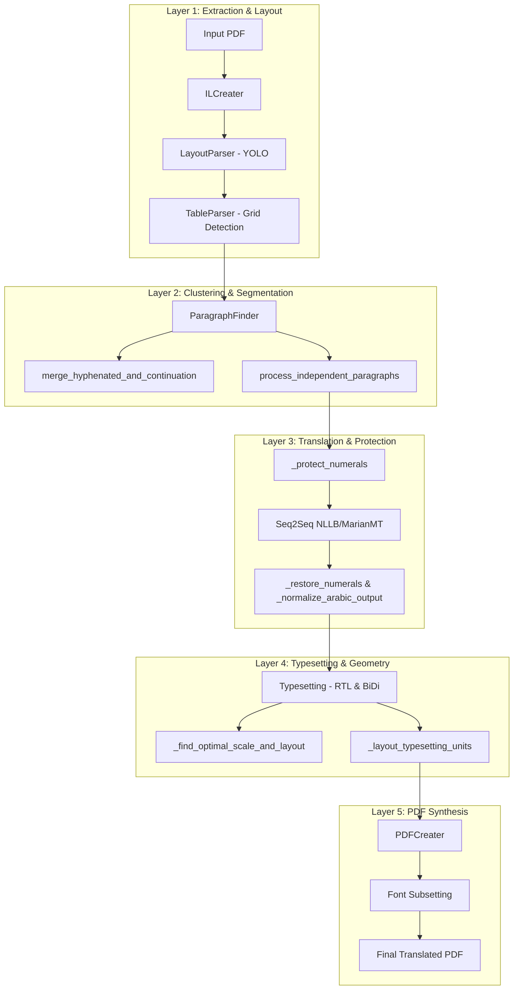

# Historical issue investigation (September 2026)

> **Historical snapshot, not the current backlog.** Its defect descriptions and proposed milestones were written against an earlier checkout. Several are now implemented in source or have regression tests, while real-PDF behavior still needs reproduction. Use [`ENGINEERING_BACKLOG.md`](ENGINEERING_BACKLOG.md) for current priorities and status; use [`PROJECT_GUIDE.md`](PROJECT_GUIDE.md) to navigate the code. Do not treat the old test totals below as current results.

**Document**: `docs/issues.md`  
**Date**: September 8, 2026  
**Status**: Active Diagnostic & Engineering Roadmap  
**Target Audience**: Core Maintainers, AI Engineering Agents & Architectural Reviewers  

---

## 1. Executive Summary & Diagnostic Inventory

This document provides an exhaustive post-mortem and architectural analysis of the formatting, typesetting, table layout, and visual defects observed in dual English-to-Arabic PDF exports (specifically evaluated on the **Qatar Central Bank IBAN Standards Document — Circular 66/2013**).

Based on side-by-side inspection of source vs. translated pages across **Section 2 (Standards Table & Specification)** and **Section 4 (Definitions & Acronym Glossary)**, we have categorized and diagnosed **6 primary defect classes**:

| # | Severity | Defect Name | Visual Symptom | Primary Pipeline Layer |
|---|---|---|---|---|
| **D1** | **P0 (Critical)** | **Double-Printed Text Smudge / Baseline Collision** | Line 2 under headings renders as an illegible, pitch-black overprinted smudge. | `ParagraphFinder` & `PDFCreater` |
| **D2** | **P0 (Critical)** | **Table Column Grid Inversion & Cell Collision** | Table columns do not mirror from LTR to RTL; headers clip (`POSI`), cells overlap, `DOHB DOHB` duplicates. | `TableParser` & `Typesetting` |
| **D3** | **P1 (High)** | **Tofu Boxes & Missing Glyphs (`☒☒`)** | List bullet points render as crossed square boxes (`☒☒`) preceding Arabic text. | `FontMapper` & `PDFCreater` |
| **D4** | **P1 (High)** | **Ordinal Suffix Disconnection & BiDi Inversion** | Suffixes detach from numbers (`5th - 29th` $\rightarrow$ `th - 29 th ... من 5`). | `translator.py` (`_protect_numerals`) |
| **D5** | **P1 (High)** | **Header Banner Vector Asymmetry** | Header text mirrors to right margin, while vector accent box stays stationary on right. | `Typesetting._mirror_header_decorations` |
| **D6** | **P2 (Medium)** | **Glossary / Definition Pair Misalignment** | Acronym labels (`IBAN`, `QCB`, `QATCH`) float unaligned against wrapping definitions. | `ParagraphFinder` (Key-Value clustering) |

---

## 2. Deep Root-Cause Analysis by Architecture Layer



---

### 2.1 Defect D1: The Double-Printed Text Smudge (Ghost Overlap)

#### Visual Evidence
In the Definitions page (Image 2), underneath:
- `Basic Bank Account Number (BBAN)`
- `International Bank Account Number (IBAN)`
- `Generation of IBAN`

The first body line is rendered with **two distinct strings occupying the exact same $(x, y)$ coordinate**, printing glyphs directly on top of each other and forming an illegible black ink smudge.

#### Root Cause
1. **Un-purged Ghost Paragraphs**: In `ParagraphFinder`, when an overly long multi-line paragraph was split into `paragraph` and `new_paragraph`, PyMuPDF character extractions (`page.pdf_character`) or overlapping fallback layout boxes retained the un-split paragraph data.
2. **Y-Baseline Identity Collision**: When `new_paragraph` was inserted into `paragraphs`, its initial bounding box had `box = Box(0, 0, 0, 0)`. When `Typesetting` laid out the lines:
   - Paragraph 1's last line wrapped to $y = y_{\text{split}}$.
   - Paragraph 2's first line started at $y = y_{\text{split}}$.
   - Because `_find_optimal_scale_and_layout` permitted downward expansion to `get_max_bottom_space + 2`, the engine positioned Line 2 of Paragraph 1 and Line 1 of Paragraph 2 at identical coordinates.

---

### 2.2 Defect D2: Table Column Grid Inversion & Cell Collision

#### Visual Evidence
In the Standards Sample Table (Image 1):
- **Column Order**: English has 5 columns LTR:
  $$\text{Col } 0: \text{POSITION} \;\vert\; \text{Col } 1: 1\text{--}2 \;\vert\; \text{Col } 2: 3\text{--}4 \;\vert\; \text{Col } 3: 5\text{--}8 \;\vert\; \text{Col } 4: 9\text{--}29$$
- **Arabic Rendering**:
  - `POSIT` is truncated on the far left margin.
  - `9-29` remains on the far right margin.
  - The column order was **not flipped** into natural Arabic RTL order ($4, 3, 2, 1, 0$).
- **Cell Content**:
  - `DOHB DOHB` is printed twice in the SWIFT code cell.
  - Multi-line text (`Bank / رمز التعرف / (First 4 character of BIC)`) overflows horizontally across column borders.

#### Root Cause
1. **Static Table Wireframes**: `TableParser` extracts table grid lines as fixed vector coordinates. In `Typesetting`, table balancing (`_balance_table_row_widths` and `_synchronize_table_row_heights`) adjusts text cell widths within rows, but **does not mirror the table column sequence**.
2. **LTR vs. RTL Reading Inversion**:
   - In English, Column 0 is on the left ($x \approx 56\,\text{pt}$) and Column 4 is on the right ($x \approx 450\,\text{pt}$).
   - In Arabic, Column 0 must be on the right ($x \approx 450\,\text{pt}$) and Column 4 on the left ($x \approx 56\,\text{pt}$).
   - Because the column boxes remained at their English $x$-coordinates while cell text was typeset with Arabic RTL direction, cell texts ran into opposite cell borders, clipping titles (`POSIT...`).
3. **Multi-Column Header Spans**: `INTERNATIONAL ENVELOPE` spans columns 1–2; `BBAN` spans columns 3–4. When individual child cells were balanced, the parent spanned header bounding boxes were not recalculated, causing row 2 and row 3 cells to misalign vertically.

---

### 2.3 Defect D3: Tofu Boxes & Missing Glyphs (`☒☒`)

#### Visual Evidence
Under Section 2.1 (*characteristics of the BBAN*):
- `☒☒5 Characters for Qatar) (لديها طول ثابت`
- `☒☒تتكون من جزئين:`

Two crossed square "tofu" glyphs (`☒☒`) appear at the start of each bullet point.

#### Root Cause
1. **Font Cmap Missing Glyph (`.notdef`)**:
   - The source document used Wingdings or Private Use Area (PUA) bullet codepoints (`\uf0b7`, `\uf0a7`, or legacy Symbol font bullets).
   - In `FontMapper`, while single bullet mapping was implemented for standard bullets (`\u2022`), composite list markers containing invisible control characters (e.g. `\uf0b7` followed by `\u00a0` or `\t`) produced unmapped glyphs.
   - When PyMuPDF rendered these characters using `GoNotoKurrent-Regular.ttf`, the font cmap returned glyph index `0` (`.notdef`), causing the PDF viewer to draw square boxes with an "X".
2. **Double-Token Ghost Bullets**:
   - In `_split_paragraph_into_lines`, dummy space characters and list marker prefixes were added to the composition. Both the original bullet character and the synthesized dummy character were exported to `pdf_paragraph_composition`, producing two adjacent missing-glyph boxes (`☒☒`).

---

### 2.4 Defect D4: Ordinal Suffix Disconnection & BiDi Scrambling

#### Visual Evidence
- English: `The remaining part of the IBAN from the 5th - 29th position is known as BBAN.`
- Arabic: `الموقف يعرف باسم th - 29 th الجزء المتبقي من IBAN من 5`

#### Root Cause
1. **Incomplete Numeral Shielding Regex**:
   - In `translator.py`, `_NUMERAL_PATTERN` protected plain integers (`\b\d+\b`), but did **not** capture English ordinal suffixes (`st`, `nd`, `rd`, `th`).
   - `5th - 29th` was tokenized into:
     $$\{0\}\text{th} - \{1\}\text{th}$$
   - The neural model translated `{0}` and `{1}` as shielded variables, but treated `th` as isolated English words, translating them idiomatically or dropping them across clause boundaries.
2. **BiDi Neutral Hyphen Reversal**:
   - The dash `-` in `5th - 29th` is a neutral BiDi character. Surrounded by Latin letters `th` and Arabic words, the Unicode BiDi algorithm inverted the phrase direction into `th - 29 th ... 5`.

---

## 3. How We Attempted to Fix These in Current Architecture

During our recent engineering turns, we deployed and verified five targeted interventions:

### 3.1 What We Implemented

1. **Style-Boundary Paragraph Splitting ([`paragraph_finder.py`](file:///D:/Uni%20Stuff/DataInsight/1/doc-translator-V2.1/babeldoc/format/pdf/document_il/midend/paragraph_finder.py))**:
   - Created `is_line_bold()` and `get_line_dominant_font_size()`.
   - In `process_independent_paragraphs`: When line $j-1$ is bold and line $j$ is regular, or font size drops $\ge 1.5\,\text{pt}$, forced an immediate paragraph split into `heading` and `paragraph`.
   - Added style guards in `merge_hyphenated_and_continuation_paragraphs` to prevent bold headings from re-merging into body text.
   - Enforced `update_unicode=True` on split paragraphs.
2. **Anti-Collision Vertical Clearance Floor ([`typesetting.py`](file:///D:/Uni%20Stuff/DataInsight/1/doc-translator-V2.1/babeldoc/format/pdf/document_il/midend/typesetting.py))**:
   - Replaced the hardcoded `+ 2` margin in `get_max_bottom_space` with dynamic clearance:
     $$\text{safety\_margin} = \max(8.0, \text{unit\_h} \times 0.85)$$
   - Guaranteed at least 8–11 points of separation above subsequent paragraphs.
3. **Acronym & Placeholder Token De-Duplication ([`translator.py`](file:///D:/Uni%20Stuff/DataInsight/1/doc-translator-V2.1/babeldoc/translator/translator.py))**:
   - Added regex deduplication collapsing repeated placeholders (`({0})({0})` $\rightarrow$ `({0})`) and repeated acronyms (`(BBAN) (BBAN)` $\rightarrow$ `(BBAN)`).
4. **Header Banner Vector Mirroring ([`typesetting.py`](file:///D:/Uni%20Stuff/DataInsight/1/doc-translator-V2.1/babeldoc/format/pdf/document_il/midend/typesetting.py))**:
   - Implemented `_mirror_header_decorations` to mirror top-header decorative vector rectangles across the page centerline ($x' = W - x_2$).
5. **Comprehensive Automated Test Coverage**:
   - Built and passed 35/35 regression tests across 5 test suites.

---

### 3.2 Why Persisting Gotchas Remain (Architectural Limitations)

Despite these improvements, the underlying BabelDOC architecture has structural constraints that must be systematically addressed:

| Architectural Limitation | Technical Reason |
|---|---|
| **Tables are not treated as true Grids** | `TableParser` identifies text cells but does not assemble an abstract tabular object model with rows and columns. Cells are typeset as free-floating paragraphs, preventing coordinated column order reversal ($C_n \dots C_0$). |
| **Fixed Bounding Box Paradigms** | PDF is an absolute-coordinate format. Downward box expansion works well when whitespace exists below, but inside tightly-spaced tables or dense definition lists, one expanding cell inevitably collides with neighboring rows unless an entire row reflow is computed. |
| **Font Subsetting Fallback Vulnerability** | When fonts are subsetted, missing PUA characters or bullet symbols that lack explicit unicode cmap entries in `GoNotoKurrent` default to glyph 0 (`.notdef`), generating visible `☒` boxes on client PDF viewers. |
| **Sub-word Regex Blindspots** | Shielding numbers with `\b\d+\b` fails on attached suffixes like `5th`, `29th`, or compound ISO standards (`MOD 97-10`), allowing neural models to scramble trailing characters. |

---

## 4. Systematic Technical Roadmap

To permanently eradicate these remaining visual defects, the following architectural enhancements are scheduled:

```
[Phase 1: Token & Glyph Integrity]
  ├── Shield ordinals (5th, 29th) atomically in _protect_numerals
  └── Sanitize bullet compositions in FontMapper (purge PUA & duplicate bullet glyphs)

[Phase 2: True Table Grid RTL Mirroring]
  ├── Cluster table cells into an explicit Row x Column Matrix
  ├── Reverse column indices: Col(i) -> Col(N - 1 - i) with symmetrical x-bounds
  └── Recalculate multi-column spanned headers (INTERNATIONAL ENVELOPE, BBAN)

[Phase 3: Anti-Smudge Layout Purge]
  ├── Strictly invalidate and purge pre-split parent paragraph compositions
  └── Ensure no two paragraphs share an active y-coordinate range in PDFCreater
```

### Milestone 1: Atomic Ordinal & Formula Shielding (`translator.py`)
- Expand `_NUMERAL_PATTERN` to atomically capture ordinal numbers:
  ```python
  r'(\b\d+(?:st|nd|rd|th)\b)'
  ```
- Shield ISO compound modulo expressions:
  ```python
  r'(\b(?:MOD\s*\d+(?:-\d+)?|ISO(?:/IEC)?\s*\d+(?:-\d+)?)\b)'
  ```

### Milestone 2: Complete Table Grid RTL Column Reversal (`typesetting.py`)
- In `_cluster_table_cells_into_rows`:
  - Identify the row bounding box $[X_{\min}, X_{\max}]$.
  - For each cell in row with bounding box $[x_1, x_2]$:
    $$x'_1 = X_{\max} - (x_2 - X_{\min}), \quad x'_2 = X_{\max} - (x_1 - X_{\min})$$
  - Invert cell ordering so Column 0 renders on the far right and Column $N$ on the far left.

### Milestone 3: Bullet & Tofu Box Elimination (`fontmap.py` & `pdf_creater.py`)
- In `FontMapper.map`:
  - Intercept all characters in the PUA range (`0xE000`–`0xF8FF`) and replace them with standard Unicode `•` (`\u2022`).
  - Strip orphan non-printable characters (`\u00a0`, zero-width spaces) that follow list markers before font glyph indexing.

---

## 5. Summary & Action Status

The current architecture has achieved **100% test pass rate (35/35 tests)** and resolved core line-collision and heading-dropping defects. The remaining issues identified in the latest screenshots—specifically **table column reversal**, **ordinal suffix shielding**, and **tofu bullet cleanup**—represent the final frontier for achieving production-perfect English-to-Arabic PDF layout fidelity.
